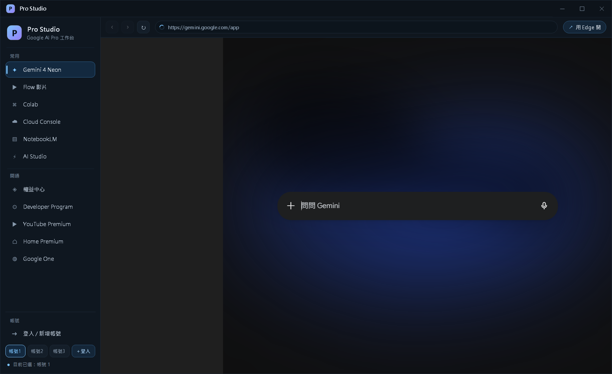

# Pro Studio

A Windows desktop workbench that puts your Google AI Pro services in one window: **Gemini, Flow, Colab, Cloud Console, NotebookLM, AI Studio**. Sign in once, everything works; switch between three Google accounts with one click.

> Not an official Google product. It is a native Windows shell around Edge WebView2 — every page is the real Google website.



## Features

- **Unified sign-in** — all services share one WebView2 profile, so one Google login covers everything
- **One-click account switch** — three account slots, reloads with Google's `authuser` parameter
- **Native shell** — frameless custom title bar (drag / double-click to maximize), Win11 rounded corners + shadow, window bounds remembered
- **Splash screen** — main window appears only after WebView2 is ready, no white flash
- **Single instance** — launching again brings the existing window to front
- **Tray icon** — closing the window minimizes to tray; quit from the tray menu
- **Shortcuts** — `Ctrl+1..6` switch service, `Ctrl+R` reload, `Ctrl+L` show URL, `F11` fullscreen

## Requirements

- Windows 10 1809+ / Windows 11
- [WebView2 Runtime](https://developer.microsoft.com/microsoft-edge/webview2/) (bundled with Win11, usually present on Win10 via Edge)
- .NET Framework 4.8 (built into Windows)

## Download

Grab `ProStudio.exe` from [Releases](../../releases). No installer needed.

## Build from source

```powershell
.\build.ps1
```

The script downloads the WebView2 SDK, compiles with the built-in `csc.exe`, and produces a single-file `dist\Pro Studio.exe` (DLLs embedded).

## Layout

```
src/Program.cs     all code (WinForms + WebView2, custom-drawn UI)
assets/app.ico     app icon (multi-size)
assets/preview.png screenshot
build.ps1          build script (csc, no SDK required)
```

## Known limitations

- Service availability depends on your Google plan and region (Flow is region-restricted, for example)
- If Google changes a web UI, a service may look broken until you reload
- Account switching relies on Google's `authuser` mechanism and only works for accounts already signed in

## License

MIT
