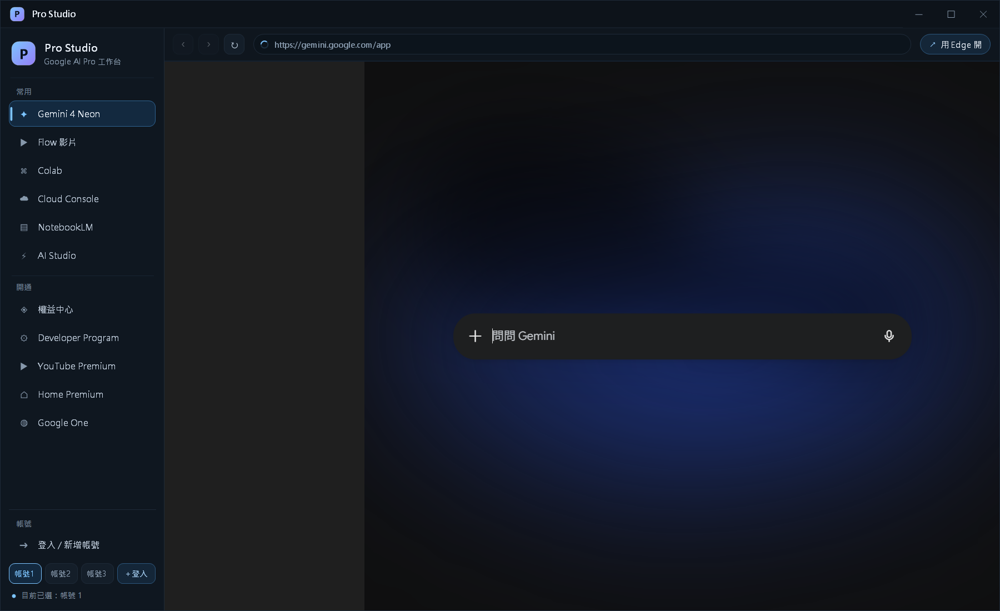

# Pro Studio

**[English](README.en.md)** · 繁體中文

一個 Windows 桌面工作台，把 Google AI Pro 訂閱裡的幾個服務收進同一個視窗：**Gemini、Flow、Colab、Cloud Console、NotebookLM、AI Studio**。登入一次，全部通用；三個 Google 帳號一鍵切換。

> 不是 Google 官方產品，只是一個包了 Edge WebView2 的原生外殼。所有頁面都是 Google 官方網站。



## 功能

- **統一登入**：所有服務共用同一個 WebView2 設定檔，登入一次全站生效
- **一鍵切帳號**：支援 3 個 Google 帳號，切換時自動帶 `authuser` 參數重載
- **原生外殼**：無邊框自繪標題列（拖曳／雙擊最大化）、Win11 圓角＋陰影、視窗大小記憶
- **啟動畫面**：WebView2 初始化完成才顯示主視窗，不會白屏
- **單一實例**：重複開啟會把原本的視窗叫回前景
- **系統托盤**：關閉＝縮到托盤，托盤右鍵才真正退出
- **快捷鍵**：`Ctrl+1..6` 切服務、`Ctrl+R` 重載、`Ctrl+L` 看網址、`F11` 全螢幕

## 系統需求

- Windows 10 1809+ / Windows 11
- [WebView2 Runtime](https://developer.microsoft.com/microsoft-edge/webview2/)（Win11 內建，Win10 多半已隨 Edge 安裝）
- .NET Framework 4.8（Windows 內建）

## 下載

到 [Releases](../../releases) 下載 `Pro Studio.exe`，雙擊即用，免安裝。

## 從原始碼編譯

```powershell
.\build.ps1
```

腳本會自動下載 WebView2 SDK、用系統內建的 `csc.exe` 編譯，輸出 `dist\Pro Studio.exe`（單一檔案，DLL 已內嵌）。

## 專案結構

```
src/Program.cs     全部程式碼（WinForms + WebView2，自繪 UI）
assets/app.ico     應用圖示（多尺寸）
assets/preview.png 截圖
build.ps1          建置腳本（csc，免 SDK）
```

## 已知限制

- 各服務可用性取決於你的 Google 帳號方案與所在地區（例如 Flow 有地區限制）
- Google 若調整網頁結構，個別服務可能暫時顯示異常，重新整理即可
- 帳號切換走 Google 的 `authuser` 機制，只對「已登入過」的帳號有效

## 授權

MIT
